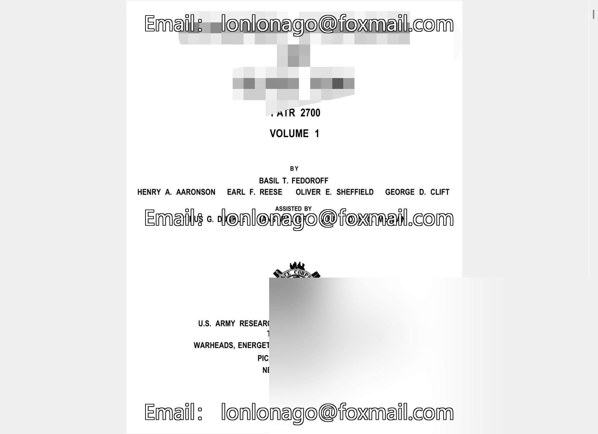
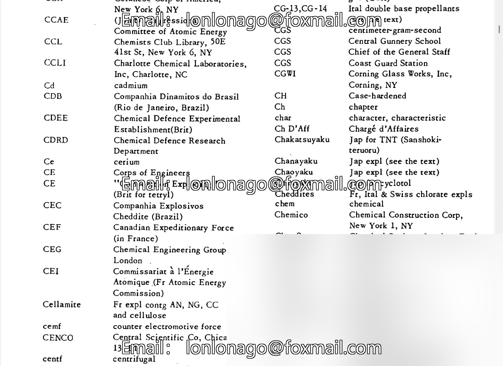
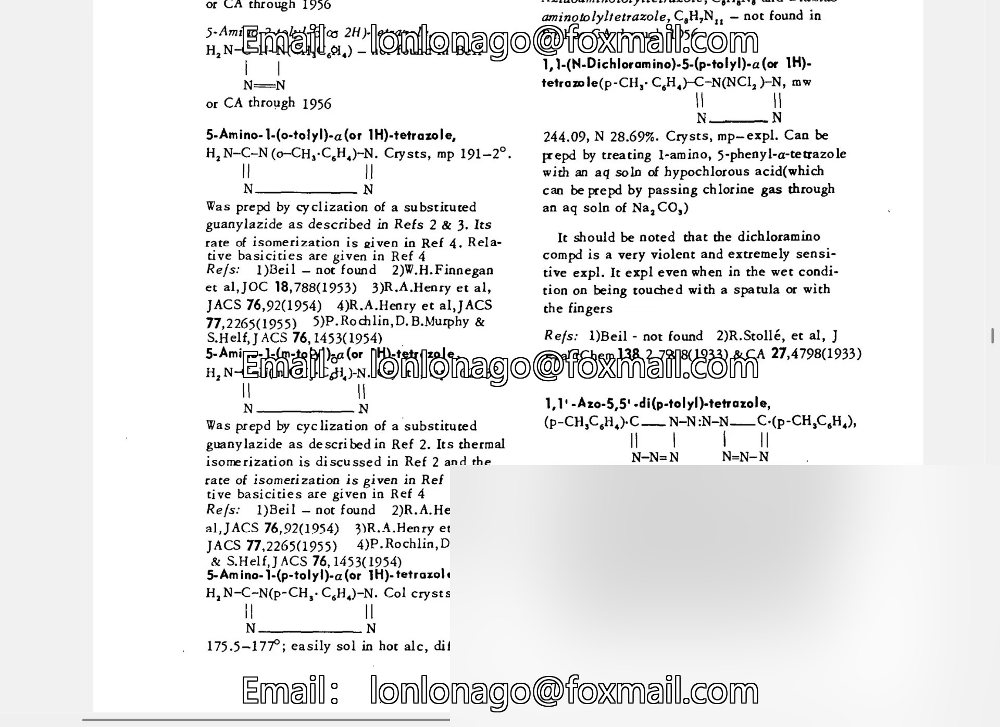
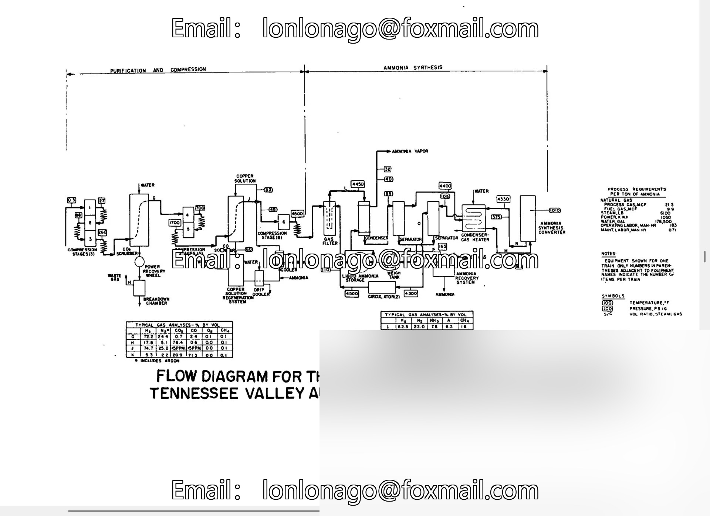

# Encyclopedia of Explosives and Related Items

## Body

The Encyclopedia of Explosives and Related Items is a multi-volume authoritative professional reference book published by the Picatinny Arsenal in the United States. The editor-in-chief is composed of individuals such as Basil T. Fedoroff.

This series compiles from the debut of the first volume in 1960 to the completion of the tenth volume in 1983. 10 volumes in total. Total approximately 7980 pages. Its content not only includes various single-mass explosives and Blast dosage, The detailed formulation of propellant Performance data and preparation method It also involves relevant chemical substances. Historical background and specific applications.
Ten volumes complete, rare research materials.
non-refundable if sold, non-reclaimable.

## Images

## Payment

Here is a pay link on Stripe ( https://buy.stripe.com/3cs8yP7sY87d0vu9AB ). Please contact me lonlonago@foxmail.com after funding $89, and I will send you a complete data files , thank you!

